# Pitchee Android

**English** | [简体中文](README.zh-CN.md)

  
  
  
  
  

Pitchee is a voice-training app for transgender people. It helps you analyze your voice, track pitch, and follow changes over time.

Unlike Voice Tools, which mostly uses pitch to infer gender expression, Pitchee analyzes pitch, timbre (resonance), and naturalness (whether the voice sounds constricted or pressed), while keeping a long-term record of how your voice changes.

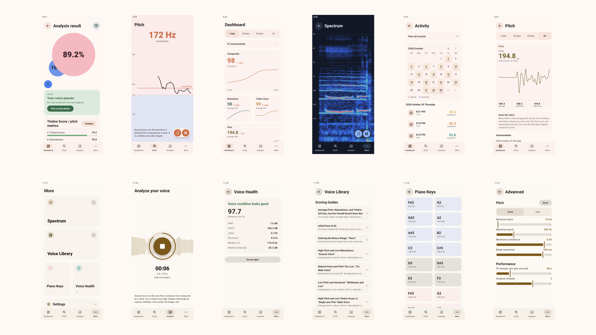

## Download

[Download the latest version (mobile)](https://github.com/project-pitchee/Pitchee-Android/releases/latest/download/app-arm64-v8a-release.apk)

Each release provides three APKs:

| APK | Device |
| --- | --- |
| `app-arm64-v8a-release.apk` | Most Android phones |
| `app-x86_64-release.apk` | Emulators |
| `app-universal-release.apk` | Use this if you are unsure about your device architecture |

A daily Nightly build is also available for trying new versions first.

## Features

### Voice analysis

Record at least 5 seconds of speech and analyze your overall score, timbre score, naturalness, and average pitch.

### Voice health

Record at least 5 seconds of speech and analyze its level of hoarseness.

### Real-time pitch

See your current pitch and recent pitch contour in real time.

### Spectrum

View changes in your voice spectrum in real time.

### Piano

Play piano keys across masculine and feminine pitch ranges.

### Dashboard

Review your assessment count, activity calendar, overall score, naturalness, timbre score, and pitch changes.

### Knowledge base

Find relevant articles when your progress reaches a plateau. Because the authors' expertise is limited, some articles were produced with assistance from DeepSeek.

### Calendar

Browse and open previous voice assessments. Assessments with retained audio can be played back directly.

## Screenshots

<table>
  <tr>
    <td align="center">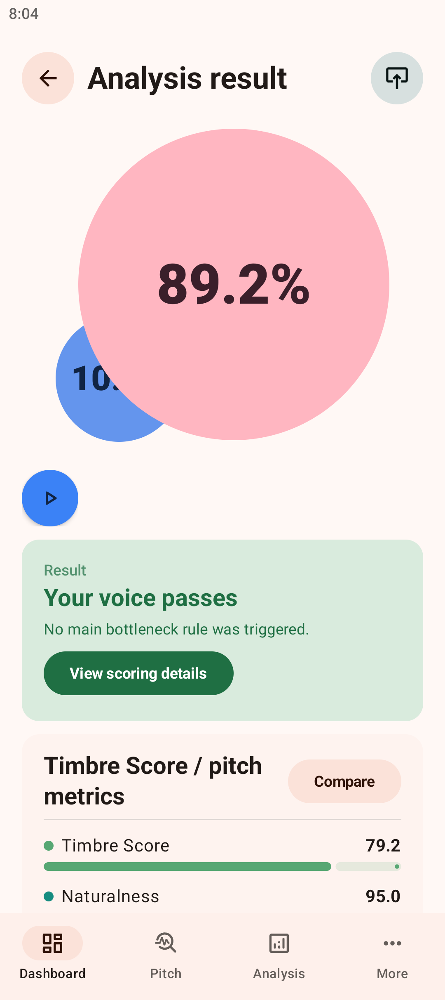 Voice analysis</td>
    <td align="center">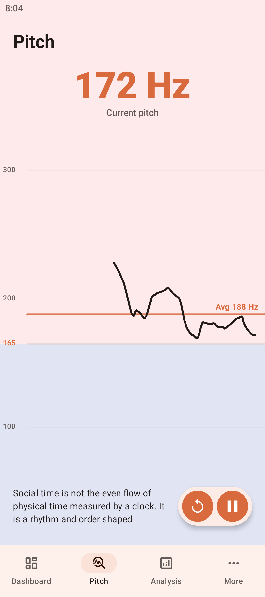 Real-time pitch</td>
    <td align="center">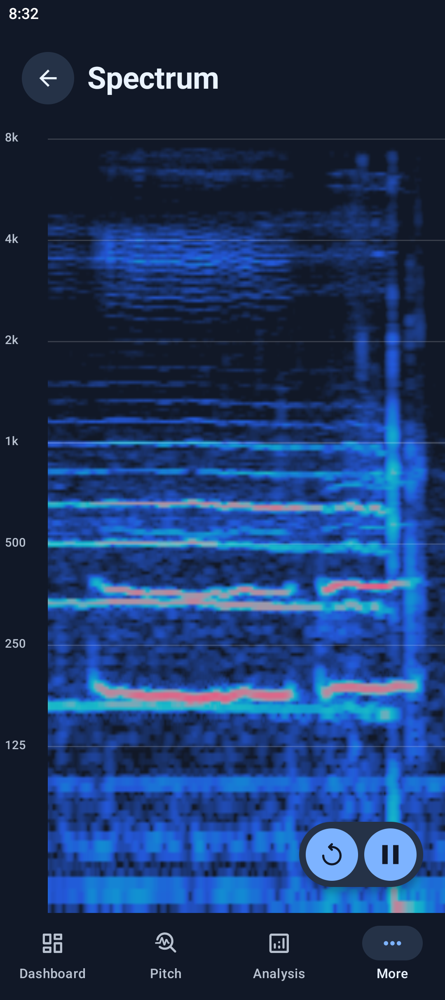 Spectrum</td>
  </tr>
  <tr>
    <td align="center">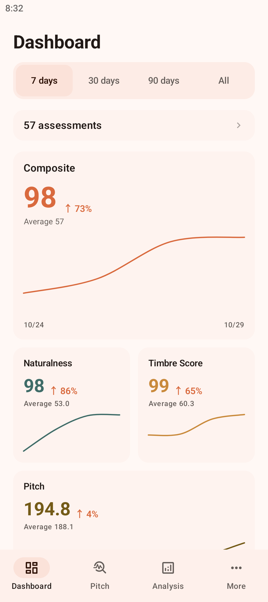 Dashboard</td>
    <td align="center">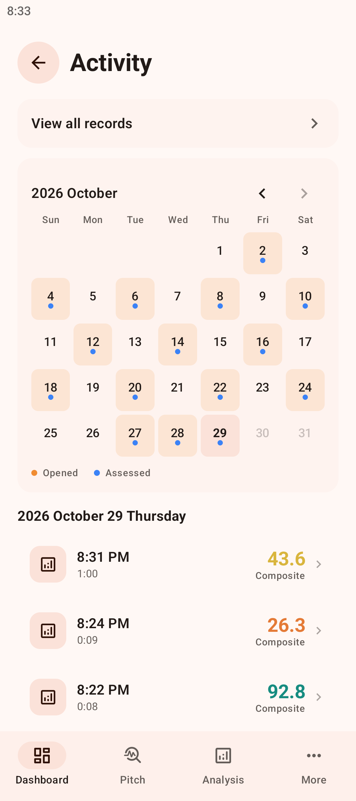 Activity</td>
    <td align="center">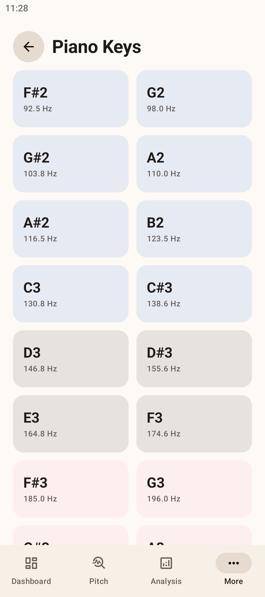 Piano</td>
  </tr>
  <tr>
    <td align="center">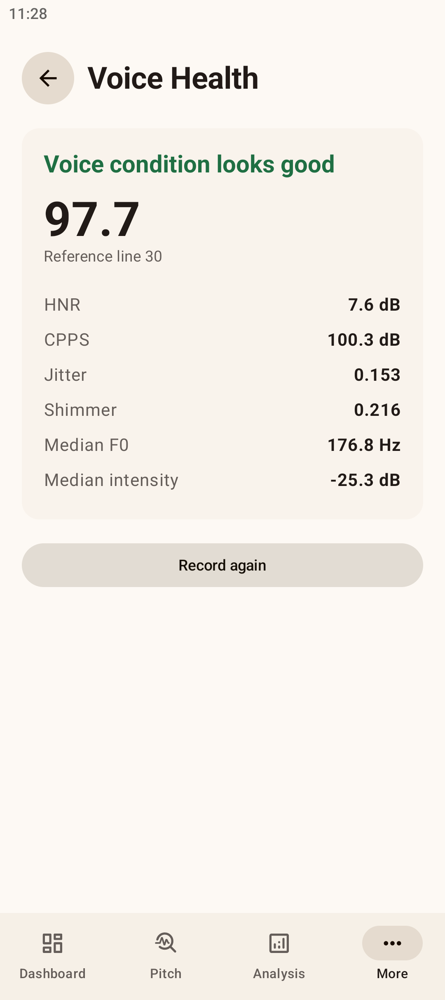 Voice health</td>
    <td align="center">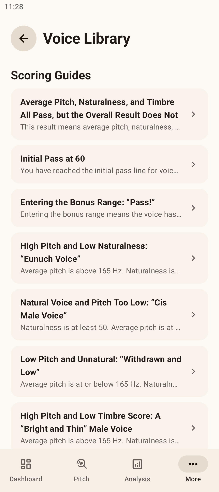 Voice knowledge base</td>
    <td align="center">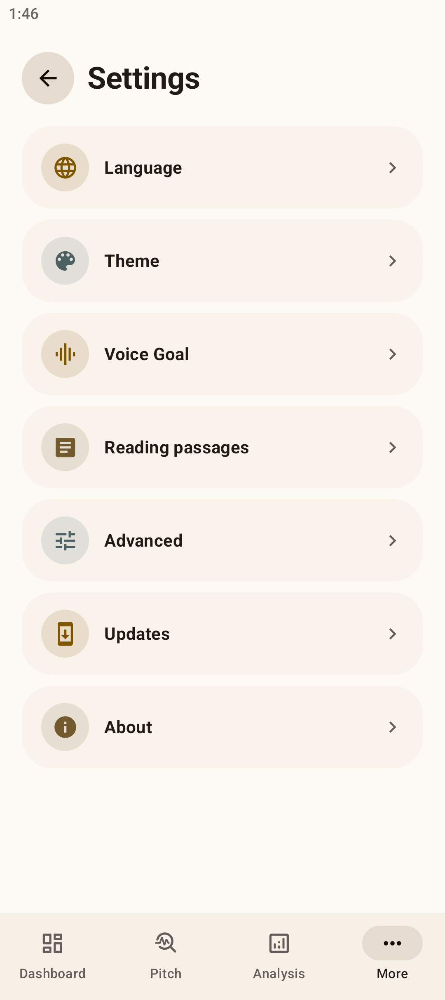 Settings</td>
  </tr>
</table>

## Model training

We trained two models to assess vocal timbre and naturalness.

### Timbre score model ([VFP](https://arxiv.org/html/2404.15176v1))

This model estimates how likely a voice is to be socially perceived as masculine or feminine. It was trained on typical binary-gender Mandarin speech and calibrated for transfeminine users using isotonic regression based on survey results distributed in August.

#### Architecture

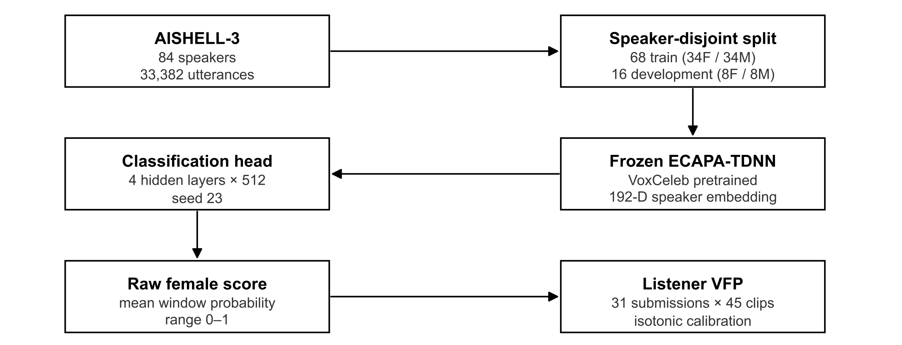

#### Datasets

| **Item** | **Data** |
| --- | --- |
| **BGC corpus** | **AISHELL-3**, read Mandarin speech |
| **BGC speakers** | **84** (**42 female / 42 male**) |
| **BGC utterances** | **33,382** |
| **Training set** | **68 speakers** (**34 female / 34 male**) |
| **Development set** | **16 speakers** (**8 female / 8 male**) |
| **Split method** | **Speaker-disjoint** |
| **Perceptual calibration recordings** | **45** |
| **Current label file** | **31 judgments per clip, 1,395 judgments total** |
| **Audio window** | **1.515 seconds** |
| **Inference hop** | **100 ms** |

#### Results

| **Metric** | **Result** |
| --- | --- |
| **Development-set female accuracy** | **100%** |
| **Development-set male accuracy** | **100%** |
| **In-sample calibration R²** | **0.8039** |
| **Leave-one-recording-out calibration R²** | **0.7082** |
| **Calibration output range** | **0–96.875** |

### Naturalness model

This model detects constricted or pressed voice and falsetto. It was trained on 121 mobile voice recordings from transgender people. The recordings came from the Pitchee beta, and permission was obtained from every uploader before training.

#### Architecture

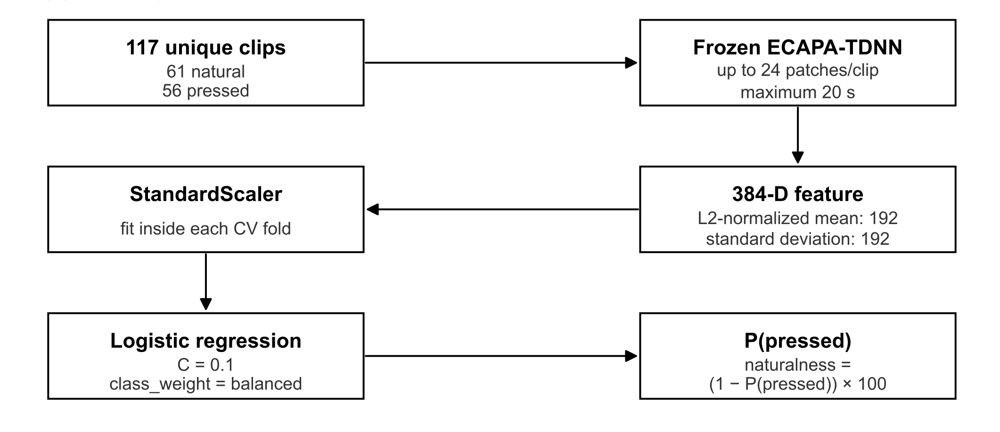

#### Results

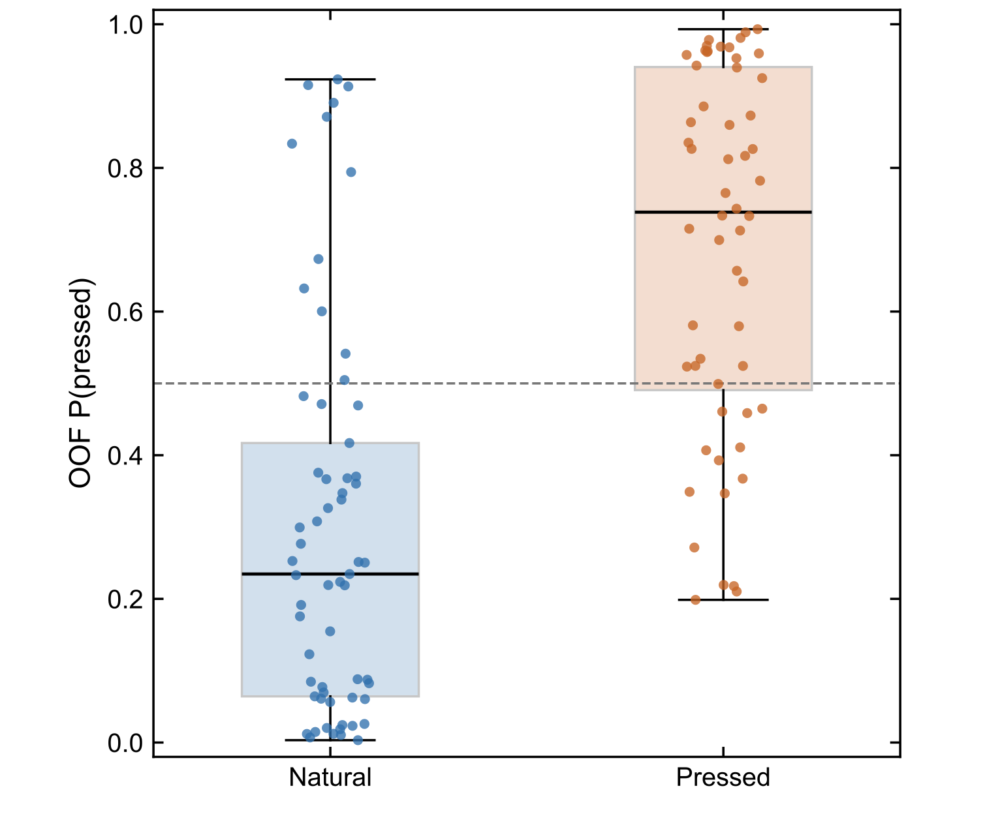

| **label** | **label_name** | **clips** | **mean_probability** | **median_probability** | **standard_deviation** |
| --- | --- | --- | --- | --- | --- |
| **0** | natural | 61 | 0.2978 | 0.2346 | 0.2738 |
| **1** | pressed | 56 | 0.6917 | 0.7384 | 0.2503 |

## Open-source references and license

Pitchee Android is released under **GPL-3.0-only**. The full license text is available in [`LICENSE`](LICENSE).

This project uses the following open-source projects:

| Project | License | Repository |
| --- | --- | --- |
| PitcheeCore | GPL-3.0-only | <https://github.com/project-pitchee/Pitchee-core> |
| SwiftF0 | MIT | <https://github.com/lars76/swift-f0> |
| Silero VAD | MIT | <https://github.com/snakers4/silero-vad> |
| SpeechBrain | Apache-2.0 | <https://github.com/speechbrain/speechbrain> |
| ncnn | BSD-3-Clause | <https://github.com/Tencent/ncnn> |
| AndroidX / Jetpack Compose | Apache-2.0 | <https://github.com/androidx/androidx> |
| Markwon | Apache-2.0 | <https://github.com/noties/Markwon> |
| Material Symbols | Apache-2.0 | <https://github.com/google/material-design-icons> |
| JLaTeXMath-Android | GPL-2.0 | <https://github.com/noties/jlatexmath-android> |
| Pitchee Articles | GPL-3.0-only | <https://github.com/Project-Pitchee/Articles> |
