# Pitchee Android

[English](README.md) | **简体中文**

  
  
  
  
  

Pitchee 是一款面向跨性别者的语音训练应用，用于分析声音、观察音高，并长期记录自己的变化。

与主要依据音高判断声音性别表达的 Voice Tools 不同，Pitchee 同时分析音高、音色（共鸣）与自然度（是否夹嗓或压嗓），并长期记录声音变化。

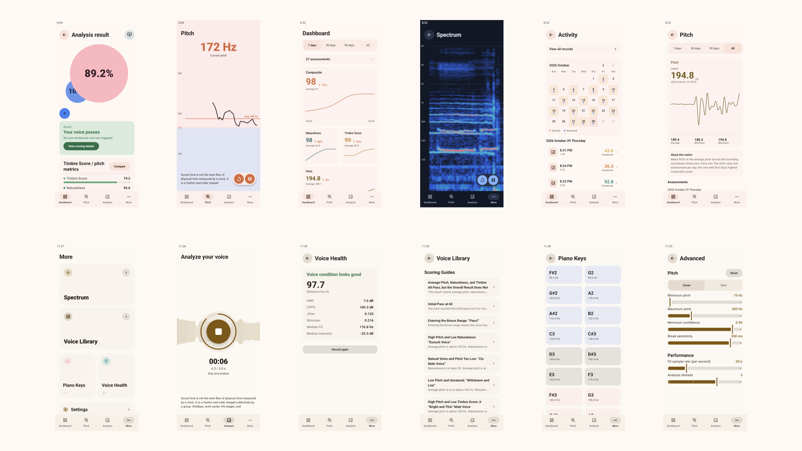

## 下载

[下载最新版（移动端）](https://github.com/project-pitchee/Pitchee-Android/releases/latest/download/app-arm64-v8a-release.apk)

每个版本提供三个 APK：

| APK | 适用设备 |
| --- | --- |
| `app-arm64-v8a-release.apk` | 普通 Android 设备 |
| `app-x86_64-release.apk` | 模拟器 |
| `app-universal-release.apk` | 不确定设备架构时使用 |

此外，应用提供 Nightly 每日构建，你可以最先体验新版本。

## 应用功能

### 声音分析

录制一段不小于 5 秒的语音，并分析综合分、音色分、自然度和平均音高。

### 声音健康

录制一段不小于 5 秒的语音，并分析其嘶哑程度。

### 实时音高

实时查看当前音高和最近一段时间的音高轨迹。

### 频谱

实时查看声音的频谱变化。

### 钢琴键

提供男性与女性音高范围内的琴键弹奏。

### 仪表盘

查看测评次数、活动日历、综合分、自然度、音色分和音高的变化。

### 知识库

当你的突破遇到瓶颈时，可以查找对应文章寻求帮助。由于作者专业知识有限，部分文章由 DeepSeek 辅助生成。

### 日历

查看并打开之前的声音测评记录；有音频的记录可以直接回放。

## 界面预览

<table>
  <tr>
    <td align="center">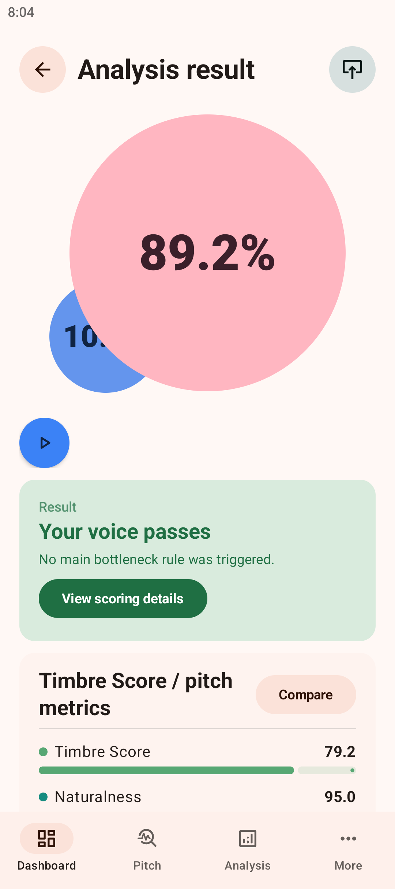 声音分析</td>
    <td align="center">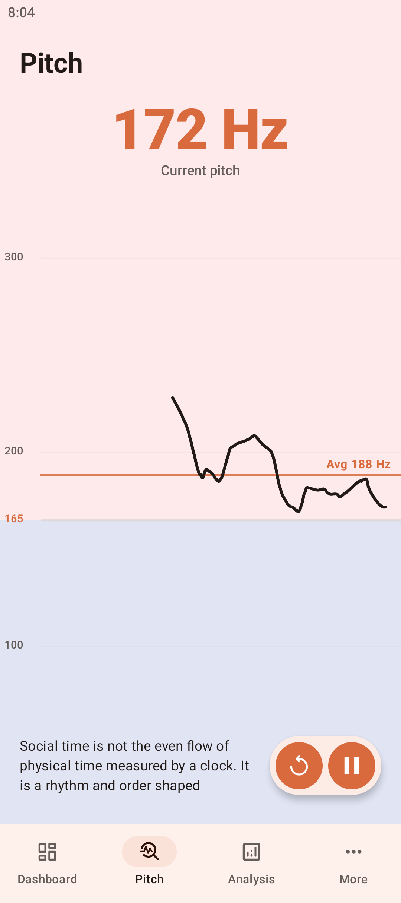 实时音高</td>
    <td align="center">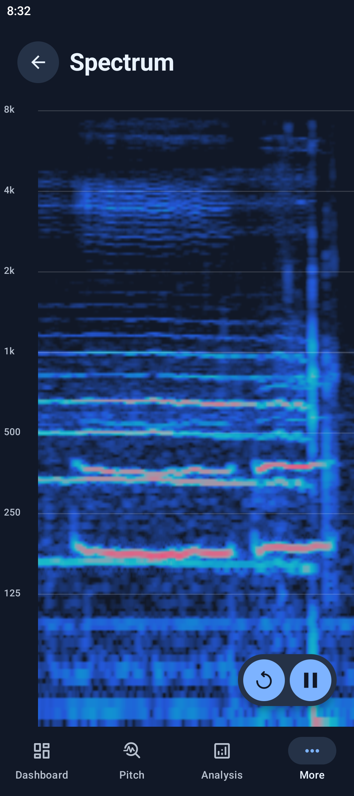 频谱</td>
  </tr>
  <tr>
    <td align="center">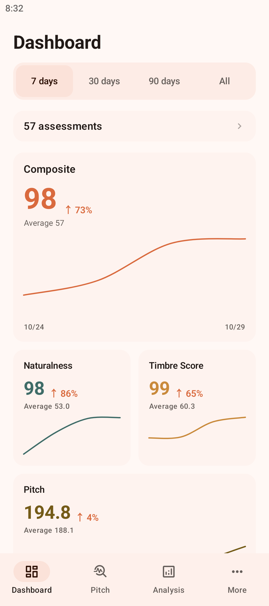 仪表盘</td>
    <td align="center">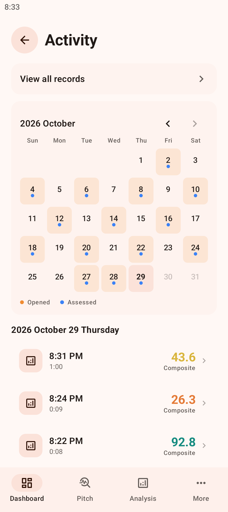 活动记录</td>
    <td align="center">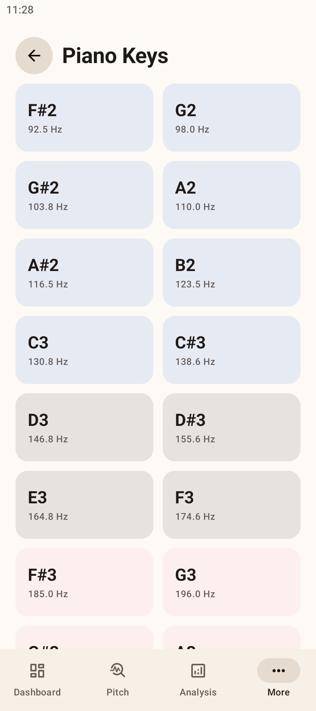 钢琴键</td>
  </tr>
  <tr>
    <td align="center">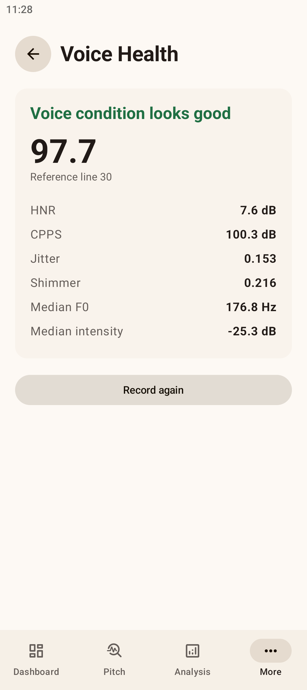 声音健康</td>
    <td align="center">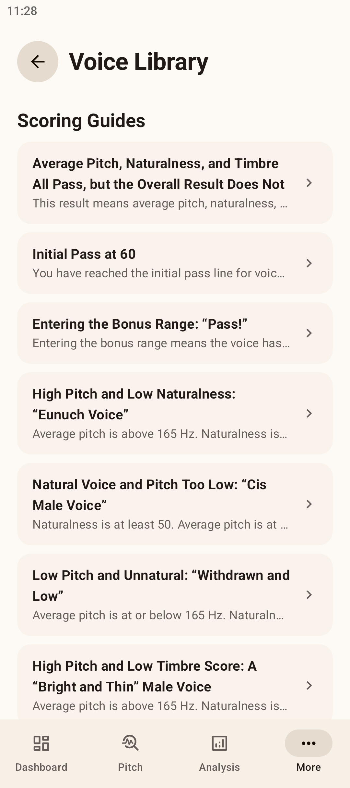 声音知识库</td>
    <td align="center">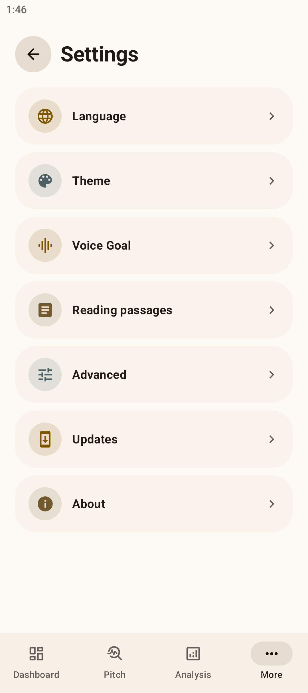 设置</td>
  </tr>
</table>

## 模型训练

我们训练了两个模型来判断嗓音的音色与自然度。

### 音色分模型（[VFP](https://arxiv.org/html/2404.15176v1)）

判断嗓音在社会上被认可为男性/女性的可能性。模型使用典型二元性别中文语音训练，并利用我们在 8 月派发的问卷结果，使用保序回归方式校正了针对跨性别女性的分数。

#### 架构

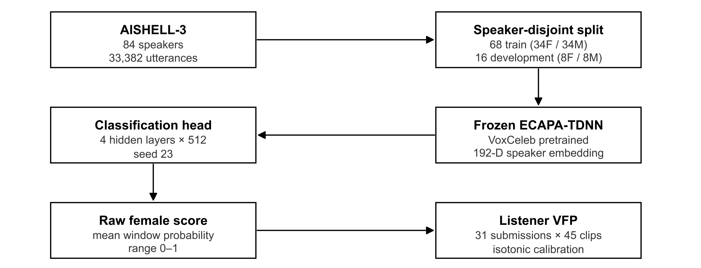

#### Datasets

| **项目**           | **数据**                                            |
| ------------------ | --------------------------------------------------- |
| **BGC** **语料**   | **AISHELL-3**，普通话朗读语音                       |
| **BGC** **说话人** | **84** **人（女性** **42 /** **男性** **42**）      |
| **BGC** **语音**   | **33,382** **条**                                   |
| **训练集**         | **68** **位说话人（女性** **34 /** **男性** **34**） |
| **开发集**         | **16** **位说话人（女性** **8 /** **男性** **8**）  |
| **划分方式**       | **说话人隔离**                                      |
| **听感校准录音**   | **45** **段**                                       |
| **当前标签文件**   | **每段** **31** **人判断，共** **1,395** **次判断** |
| **音频窗口**       | **1.515** **秒**                                    |
| **推理步长**       | **100 ms**                                          |

#### Result

| **指标**                    | **结果**     |
| --------------------------- | ------------ |
| **开发集女性准确率**        | **100%**     |
| **开发集男性准确率**        | **100%**     |
| **校准样本内** **R²**       | **0.8039**   |
| **校准留一听感录音** **R²** | **0.7082**   |
| **校准输出范围**            | **0–96.875** |

### 自然度模型

判断是否夹嗓或使用假音。模型使用 121 条移动端跨性别语音录音训练。语音来自 Pitchee 测试版，训练前已获得上传者许可。

#### 架构

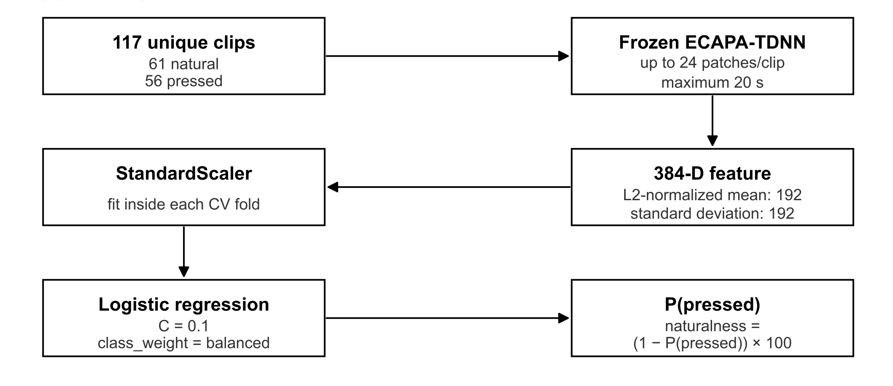

#### Result

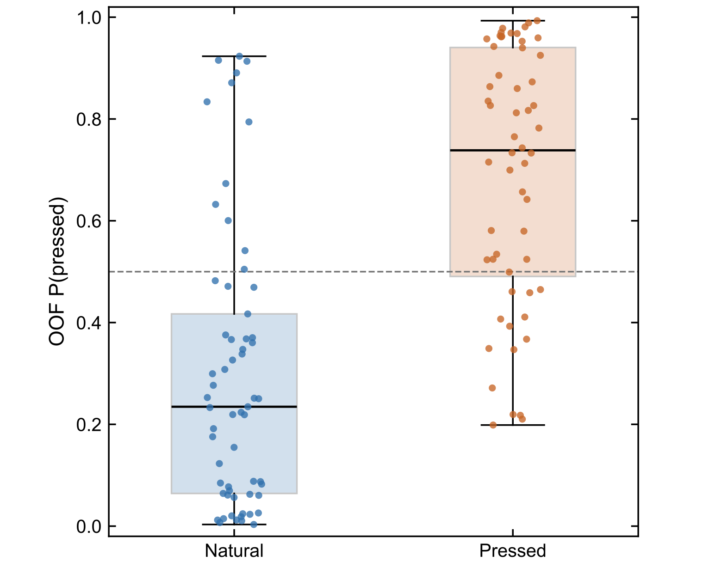

| **label** | **label_name** | **clips** | **mean_probability** | **median_probability** | **standard_deviation** |
| --------- | -------------- | --------- | -------------------- | ---------------------- | ---------------------- |
| **0**     | natural        | 61        | 0.2978               | 0.2346                 | 0.2738                 |
| **1**     | pressed        | 56        | 0.6917               | 0.7384                 | 0.2503                 |

## 开源引用与许可证

Pitchee Android 以 **GPL-3.0-only** 发布，许可证全文见 [`LICENSE`](LICENSE)。

本项目使用了以下开源项目：

| 项目 | 许可证 | 地址 |
| --- | --- | --- |
| PitcheeCore | GPL-3.0-only | <https://github.com/project-pitchee/Pitchee-core> |
| SwiftF0 | MIT | <https://github.com/lars76/swift-f0> |
| Silero VAD | MIT | <https://github.com/snakers4/silero-vad> |
| SpeechBrain | Apache-2.0 | <https://github.com/speechbrain/speechbrain> |
| ncnn | BSD-3-Clause | <https://github.com/Tencent/ncnn> |
| AndroidX / Jetpack Compose | Apache-2.0 | <https://github.com/androidx/androidx> |
| Markwon | Apache-2.0 | <https://github.com/noties/Markwon> |
| Material Symbols | Apache-2.0 | <https://github.com/google/material-design-icons> |
| JLaTeXMath-Android | GPL-2.0 | <https://github.com/noties/jlatexmath-android> |
| Pitchee Articles | GPL-3.0-only | <https://github.com/Project-Pitchee/Articles> |
